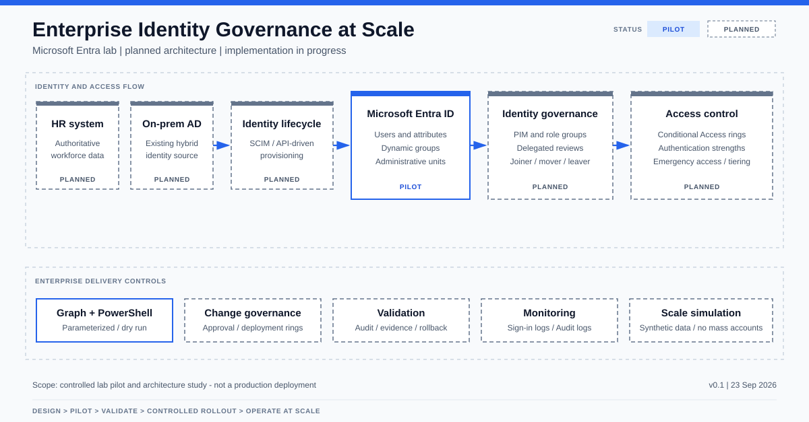

# Enterprise Identity Governance at Scale

**Microsoft Entra ID • Hybrid Identity • Identity Governance • Automation • Controlled Rollout**

This project explores how identity controls move from architecture to a small validated pilot and then to a design suitable for operation at enterprise scale.

The project is built alongside SC-300 study. Each learning area is converted into one of three outputs:

- a controlled lab implementation;
- a documented architecture decision; or
- a synthetic scale test that does not require mass creation of live identities.

## Current status

**Core lab milestones complete — approved for portfolio packaging on 2026-10-16**

The current milestone combines three deliberately different evidence levels:

- a deterministic offline preflight over 1,000 synthetic HR records;
- an approved, idempotent live batch of 10 cloud identities and four missing dynamic groups;
- a detailed two-identity Joiner/Mover/Leaver pilot with group-based E5 allocation and reclamation;
- a group-based PIM pilot using a dedicated Tier 2 identity, approval-controlled activation, an audited privileged action and automatic expiration;
- a delegated access-review pilot that preserved an automated `Deny` recommendation alongside an evidence-based human `Approved` decision and audit trail;
- a deterministic access-review operating-model test across 1,000 synthetic identities, 16 reviewer queues and explicit privileged exceptions;
- a Conditional Access deployment-ring model over 1,000 identities with explicit recovery exclusions, readiness gates and a documented no-go decision that preserved Security Defaults.

The live pilot also identified residual access in assigned groups and a pre-existing dynamic rule that did not exclude disabled identities. These findings are retained as governance evidence rather than hidden as test noise.

The PIM pilot additionally demonstrated separation of duties: the Tier 2 operator could manage ordinary group membership while a separate administrative identity inspected the directory audit record.

The delegated review then demonstrated human-in-the-loop governance: Microsoft Entra supplied an inactivity-based recommendation, the reviewer evaluated stronger current evidence in My Access, documented an override, and the administrator verified the decision and retained membership. See the [delegated access review pilot](docs/access-review-pilot.md).

Scale was then exercised locally against 1,000 deterministic identities. The [access review scale model](docs/access-review-scale-model.md) distributes responsibility, enforces a reviewer workload ceiling, separates automatic recommendations from privileged exceptions and proves repeatability with matching plan hashes.

The [Conditional Access rollout](docs/conditional-access-rollout.md) records why the prepared live report-only policy was not created: disabling Security Defaults without a validated replacement baseline would have weakened the tenant. A deterministic impact simulation then evaluated 1,000 identities across five rings and blocked promotion because MFA readiness remained below the 95 percent gate.

The architecture is planned. Existing tenant state is not assumed to implement the controls shown in the diagram. Controls become **Verified** only after a dated test and sanitized evidence record.

## Problem statement

How should identity security be designed when an organization has thousands of users, privileged administrators, hybrid infrastructure and multiple identity boundaries?

The project addresses:

- authoritative identity sources and hybrid synchronization;
- joiner, mover and leaver lifecycle;
- attribute-driven dynamic groups;
- administrative tiering and separate privileged identities;
- PIM and role-assignable groups;
- delegated access reviews;
- Conditional Access deployment rings;
- emergency-access design and recovery;
- Microsoft Graph and PowerShell automation;
- multi-tenant collaboration and governance;
- evidence, rollback and production limitations.

## Delivery model

```text
Design → Pilot → Validate → Controlled rollout → Operate at scale
```

Scale is demonstrated through parameterized automation and synthetic input. The project will not create thousands of live accounts merely to imitate an enterprise.

## Planned architecture



## Public evidence gallery

The [sanitized evidence gallery](docs/evidence/public/README.md) provides ten bounded visual artifacts covering identity lifecycle, licensing, PIM, delegated review, reviewer routing and Conditional Access rollout decisions. Raw portal captures remain excluded from Git.

## Verified outcomes

| Area | Result | Evidence |
|---|---|---|
| Identity lifecycle scale | 1,000 deterministic HR records validated | EV-IG-002 |
| Live identity batch | 10 identities applied once; second plan proposed no changes | EV-IG-004 |
| Licensing | Group allocation and reclamation observed | EV-IG-005 |
| Privileged access | PIM activation, approval, audited action and expiration | EV-IG-007 |
| Delegated governance | Human reviewer overrode an inactivity recommendation with justification | EV-IG-008 |
| Access-review scale | 1,000 identities distributed across 16 reviewer queues | EV-IG-009 |
| Conditional Access rollout | 1,000-identity impact simulation blocked unready rings | EV-IG-010 |

See the [claim and evidence matrix](docs/evidence/claim-evidence-matrix.md) for the exact publication boundary.

## Repository structure

```text
.
├── config/                 # IAM policy and entitlement mappings
├── data/                   # Synthetic HR inputs used by the lab
├── docs/
│   ├── architecture/
│   ├── decisions/
│   ├── evidence/
│   ├── environment-boundary.md
│   └── interview-requirements-traceability.md
├── outputs/                # Reproducible plans, summaries and synthetic results
├── scripts/                # Validation, planning and controlled apply automation
├── tools/                  # Local artifact builders
├── evidence-raw/           # Unsanitized portal captures; excluded from Git
├── No/                     # Superseded notes and exact duplicates; excluded from Git
├── .gitignore
└── README.md
```

## Status vocabulary

- **Owner-reported — pending verification**: supplied by the lab owner but not yet checked in a recorded portal or API session.
- **Planned**: designed but not applied.
- **Approved**: explicitly approved for application but not necessarily applied.
- **Configured**: applied but not yet fully tested.
- **Verified**: confirmed by a dated reproducible test and Evidence ID.
- **Retired**: intentionally disabled or removed with cleanup recorded.

## Safety principles

- No material cloud change without explicit approval.
- No tenant-wide enforcement before report-only evaluation and pilot validation.
- No routine automation against emergency-access identities.
- No live identifiers, credentials, tokens, private URLs or unsanitized exports in Git.
- No claim of enterprise production readiness based only on synthetic scale tests.
- Prefer workload identity, least privilege, dry-run behavior and explicit rollback.

## Completed identity-lifecycle milestone

The first milestone defined the hybrid identity model and authoritative source before any synchronization technology was selected or deployed. See [ADR-001](docs/decisions/ADR-001-hybrid-identity-model.md).

The local identity pipeline now separates HR data validation from deterministic birthright-access calculation. See the [birthright access model](docs/architecture/birthright-access-model.md). Privileged roles are deliberately excluded from HR-driven entitlement rules and remain part of a separate approval and PIM workflow.

The time-boxed implementation sequence is documented in the [project roadmap](docs/PROJECT-ROADMAP.md). The sanitized discovery result is recorded in the [current-state baseline](docs/current-state-baseline.md).

## Publication state

The claim/evidence boundary, sanitized evidence gallery, deterministic validation and publication-safety scan are complete. The Microsoft 365 E5 trial used for the live pilot expired on 2026-10-01 according to the owner's portal capture. Pilot objects are intentionally retained for later inspection; their continued premium functionality is not assumed.

Live hybrid synchronization, multi-tenant deployment, emergency-access recovery testing and Conditional Access enforcement remain explicitly outside the verified lab boundary. The final publication record is tracked in [portfolio release readiness](docs/release-readiness.md).

